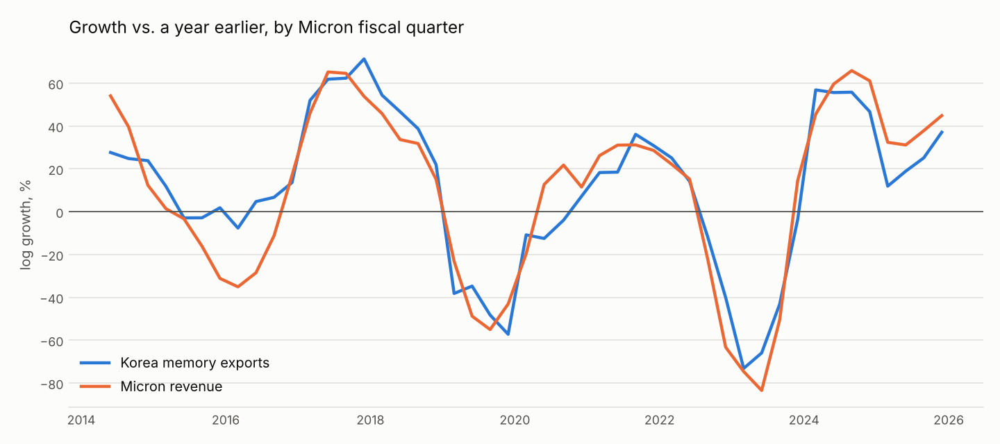

# chip-cycle

**Do Korean semiconductor exports lead the global economy?**

Korea publishes its trade data within weeks of each month ending, before
almost any other hard data on the world economy. Chips sit at the start of
nearly every supply chain, so the popular story is that chip exports turn
before everything else. This project tests that story with publication-date
alignment, out-of-sample forecasts, stress tests and a backtest, and applies
it to Micron, whose two main competitors are Korean.



## What it found

- **Micron:** Korean memory exports track Micron's revenue growth almost
  one-for-one (correlation 0.93). Out of sample, they called the direction
  of Micron's revenue growth right in 32 of 35 quarters (91%) and cut the
  error versus a naive guess by 27%.
- **Industrial production:** chip exports improve 6-month calls on whether
  US industrial production growth speeds up or slows down (63% → 82%
  correct), but make forecasts of its size worse outside COVID.
- **Markets move first:** stock prices lead chip exports by 2-4 months, so
  the trade data don't predict returns (negative out-of-sample R² in every
  test).
- **The apparent lead is fragile:** it isn't distinguishable from chance
  once the persistence of growth rates is accounted for; the forecasting
  gain came entirely from the COVID rebound; and the relationship broke in
  the 2023+ AI cycle (correlation 0.65 → 0.16).

Full write-up: [docs/FINDINGS.md](docs/FINDINGS.md). Generated results:
[results/results.md](results/results.md), [results/stress.md](results/stress.md),
[results/backtest.md](results/backtest.md).

## Stages

| Stage | What | Module |
|---|---|---|
| 1 | Data pipeline with publication-date alignment | `registry`, `ingest/`, `timing` |
| 2 | Growth rates, liquidity proxy, stationarity tests | `transforms` |
| 3 | Lead-lag: raw and prewhitened cross-correlation, Granger causality | `leadlag` |
| 4 | Stability across regimes and rolling windows | `stability` |
| 5 | Out-of-sample forecasts, Diebold-Mariano tests, market return test | `forecast` |
| 6 | Micron revenue nowcast from Korean memory exports | `micron` |
| 7 | Stress tests and accuracy backtest | `robustness`, `backtest` |

## Run it

```bash
python -m venv .venv && source .venv/bin/activate
pip install -e ".[dev]"
pytest                  # 31 tests, no network needed
chipcycle fetch         # FRED, Yahoo, UN Comtrade (≈45 min, rate limited)
chipcycle analyze       # results/results.md
chipcycle stress        # results/stress.md
chipcycle backtest      # results/backtest.md
```

Network hosts used: `fred.stlouisfed.org`, `query1.finance.yahoo.com`,
`query2.finance.yahoo.com`, `fc.yahoo.com`, `comtradeapi.un.org`,
`data.sec.gov`. Setting `COMTRADE_KEY` to a free registered key lifts
Comtrade's preview limits; `SEC_USER_AGENT` sets the contact string SEC asks
automated clients to send.

## Data

| Series | Source |
|---|---|
| Korea chip exports (HS 8542) and memory exports (HS 854232), 2013 on | UN Comtrade |
| Korea total exports, 1957 on | FRED (OECD) |
| US industrial production, Baa credit spread, Fed balance sheet, TGA, reverse repo | FRED |
| ACWI, SOX, Micron share prices | Yahoo Finance |
| Micron quarterly revenue | SEC EDGAR (XBRL) |
