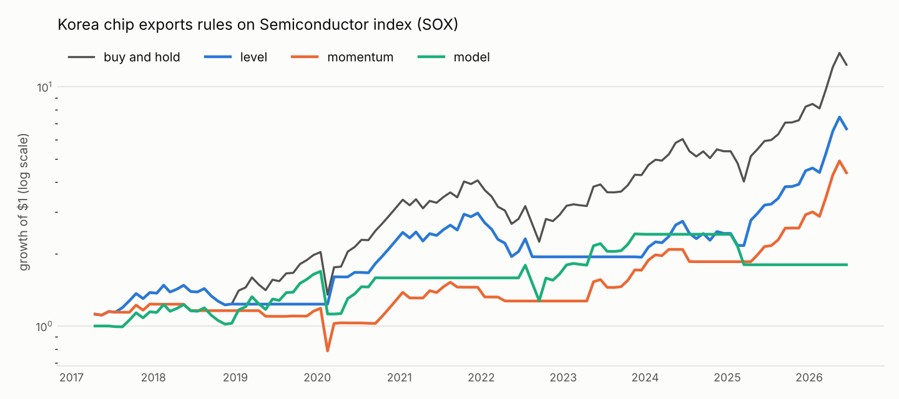
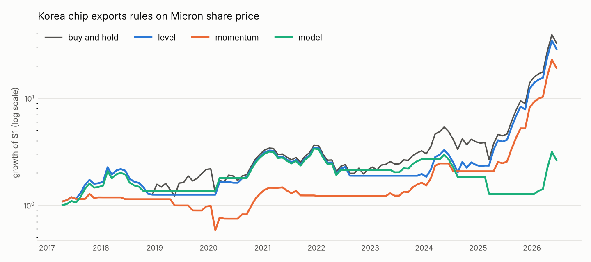
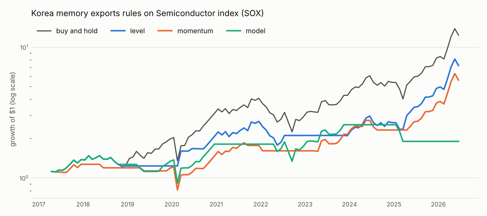
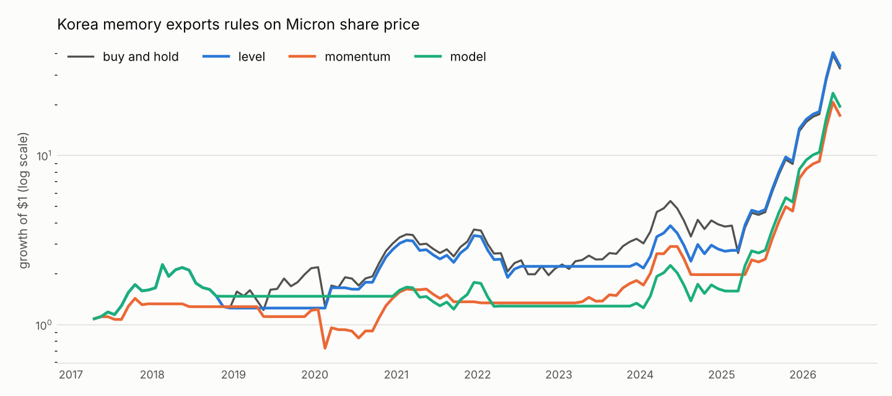

# Backtest

Generated by `chipcycle backtest`. Rules were fixed before any result was seen (see `src/chipcycle/backtest.py`) and every one is reported.

## Economy: does it call the direction right?

Will the target's growth be higher or lower in h months than today? `hit_baseline_pct` uses only the target's own history; `hit_augmented_pct` adds chip exports. `chips_add_pp` is the difference in percentage points.

| signal | target | h | n | hit_baseline_pct | hit_augmented_pct | chips_add_pp |
|---|---|---|---|---|---|---|
| kr_semi_exports | us_indpro | 1 | 93 | 49.5 | 58.1 | 8.6 |
| kr_semi_exports | us_indpro | 3 | 89 | 59.6 | 62.9 | 3.4 |
| kr_semi_exports | us_indpro | 6 | 83 | 62.7 | 78.3 | 15.7 |
| kr_semi_exports | us_baa_spread | 1 | 93 | 65.6 | 63.4 | -2.2 |
| kr_semi_exports | us_baa_spread | 3 | 89 | 68.5 | 62.9 | -5.6 |
| kr_semi_exports | us_baa_spread | 6 | 83 | 79.5 | 69.9 | -9.6 |
| kr_semi_exports | liquidity | 1 | 93 | 63.4 | 68.8 | 5.4 |
| kr_semi_exports | liquidity | 3 | 89 | 59.6 | 57.3 | -2.2 |
| kr_semi_exports | liquidity | 6 | 83 | 60.2 | 63.9 | 3.6 |
| kr_memory_exports | us_indpro | 1 | 93 | 49.5 | 60.2 | 10.8 |
| kr_memory_exports | us_indpro | 3 | 89 | 59.6 | 67.4 | 7.9 |
| kr_memory_exports | us_indpro | 6 | 83 | 62.7 | 81.9 | 19.3 |
| kr_memory_exports | us_baa_spread | 1 | 93 | 65.6 | 65.6 | 0.0 |
| kr_memory_exports | us_baa_spread | 3 | 89 | 68.5 | 67.4 | -1.1 |
| kr_memory_exports | us_baa_spread | 6 | 83 | 79.5 | 68.7 | -10.8 |
| kr_memory_exports | liquidity | 1 | 93 | 63.4 | 67.7 | 4.3 |
| kr_memory_exports | liquidity | 3 | 89 | 59.6 | 59.6 | 0.0 |
| kr_memory_exports | liquidity | 6 | 83 | 60.2 | 63.9 | 3.6 |
| kr_exports_total | us_indpro | 1 | 771 | 57.8 | 55.8 | -2.1 |
| kr_exports_total | us_indpro | 3 | 767 | 61.1 | 59.1 | -2.1 |
| kr_exports_total | us_indpro | 6 | 761 | 61.4 | 61.5 | 0.1 |
| kr_exports_total | us_baa_spread | 1 | 423 | 64.5 | 61.7 | -2.8 |
| kr_exports_total | us_baa_spread | 3 | 419 | 64.4 | 67.3 | 2.9 |
| kr_exports_total | us_baa_spread | 6 | 413 | 69.0 | 67.6 | -1.5 |
| kr_exports_total | liquidity | 1 | 220 | 66.4 | 65.5 | -0.9 |
| kr_exports_total | liquidity | 3 | 216 | 59.3 | 53.2 | -6.0 |
| kr_exports_total | liquidity | 6 | 210 | 58.1 | 57.6 | -0.5 |

## Markets: timing rules

`random_timing_pctile`: the rule's Sharpe ratio versus 1,000 random strategies with the same time in market. Above 95 means the timing very likely added something; around 50 means it did not. `months_right_pct`: share of months the rule held during a gain or sat out a loss.

### Korea chip exports → Global equities (ACWI)

| rule | months | in_market_pct | cagr_pct | vol_pct | sharpe | max_drawdown_pct | switches | random_timing_pctile | months_right_pct |
|---|---|---|---|---|---|---|---|---|---|
| buy and hold | 111 | 100.00 | 12.51 | 18.20 | 0.65 | -30.21 | 0 |  | 69.37 |
| level | 111 | 70.27 | 10.33 | 11.09 | 0.89 | -22.04 | 10 | 87.10 | 57.66 |
| momentum | 111 | 48.65 | 5.95 | 14.73 | 0.39 | -30.21 | 28 | 46.20 | 57.66 |
| model | 111 | 54.95 | 1.30 | 16.29 | 0.08 | -30.48 | 10 | 1.50 | 42.34 |

### Korea chip exports → Semiconductor index (SOX)

| rule | months | in_market_pct | cagr_pct | vol_pct | sharpe | max_drawdown_pct | switches | random_timing_pctile | months_right_pct |
|---|---|---|---|---|---|---|---|---|---|
| buy and hold | 111 | 100.00 | 31.22 | 32.36 | 0.84 | -44.56 | 0 |  | 61.26 |
| level | 111 | 70.27 | 22.76 | 24.56 | 0.83 | -34.60 | 10 | 77.90 | 51.35 |
| momentum | 111 | 48.65 | 17.28 | 24.28 | 0.66 | -36.23 | 28 | 64.20 | 53.15 |
| model | 111 | 51.35 | 6.58 | 24.17 | 0.26 | -33.69 | 10 | 6.80 | 46.85 |

### Korea chip exports → Micron share price

| rule | months | in_market_pct | cagr_pct | vol_pct | sharpe | max_drawdown_pct | switches | random_timing_pctile | months_right_pct |
|---|---|---|---|---|---|---|---|---|---|
| buy and hold | 111 | 100.00 | 45.79 | 52.66 | 0.72 | -50.73 | 0 |  | 60.36 |
| level | 111 | 70.27 | 43.83 | 44.25 | 0.82 | -46.85 | 10 | 86.80 | 54.05 |
| momentum | 111 | 48.65 | 37.61 | 39.27 | 0.81 | -54.37 | 28 | 91.00 | 57.66 |
| model | 111 | 52.25 | 11.04 | 36.72 | 0.29 | -62.34 | 13 | 17.80 | 48.65 |

### Korea memory exports → Global equities (ACWI)

| rule | months | in_market_pct | cagr_pct | vol_pct | sharpe | max_drawdown_pct | switches | random_timing_pctile | months_right_pct |
|---|---|---|---|---|---|---|---|---|---|
| buy and hold | 111 | 100.00 | 12.51 | 18.20 | 0.65 | -30.21 | 0 |  | 69.37 |
| level | 111 | 68.47 | 11.29 | 10.51 | 1.02 | -22.04 | 12 | 92.30 | 57.66 |
| momentum | 111 | 52.25 | 7.98 | 14.43 | 0.53 | -30.21 | 26 | 58.70 | 61.26 |
| model | 111 | 47.75 | -3.31 | 14.74 | -0.23 | -42.53 | 11 | 0.00 | 36.94 |

### Korea memory exports → Semiconductor index (SOX)

| rule | months | in_market_pct | cagr_pct | vol_pct | sharpe | max_drawdown_pct | switches | random_timing_pctile | months_right_pct |
|---|---|---|---|---|---|---|---|---|---|
| buy and hold | 111 | 100.00 | 31.22 | 32.36 | 0.84 | -44.56 | 0 |  | 61.26 |
| level | 111 | 68.47 | 23.85 | 23.64 | 0.90 | -34.19 | 12 | 84.90 | 51.35 |
| momentum | 111 | 52.25 | 20.47 | 24.65 | 0.76 | -36.40 | 26 | 73.40 | 54.95 |
| model | 111 | 51.35 | 7.19 | 25.40 | 0.27 | -38.43 | 11 | 7.60 | 48.65 |

### Korea memory exports → Micron share price

| rule | months | in_market_pct | cagr_pct | vol_pct | sharpe | max_drawdown_pct | switches | random_timing_pctile | months_right_pct |
|---|---|---|---|---|---|---|---|---|---|
| buy and hold | 111 | 100.00 | 45.79 | 52.66 | 0.72 | -50.73 | 0 |  | 60.36 |
| level | 111 | 68.47 | 46.33 | 43.67 | 0.87 | -44.62 | 12 | 91.50 | 54.05 |
| momentum | 111 | 52.25 | 36.03 | 40.51 | 0.76 | -49.23 | 26 | 86.20 | 54.05 |
| model | 111 | 57.66 | 37.84 | 40.82 | 0.79 | -45.45 | 6 | 84.10 | 50.45 |

