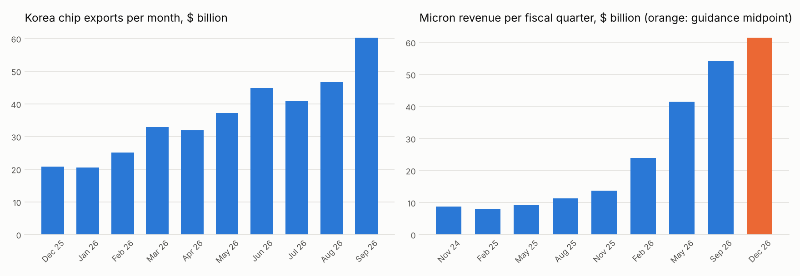

# Current memory cycle

Generated by `chipcycle cycle`. Growth is shown in ordinary percent (the model works in log points, which differ a lot at these sizes). Korean figures after December 2025 are transcribed from press reports of the trade ministry's monthly release; see `data/manual/README.md`.

## Korea semiconductor exports, monthly (ministry basis)

`three_month_vs_prior_three_pct` compares each 3-month total with the 3 months before it.

| month | level_billion | yoy_pct | mom_pct | three_month_vs_prior_three_pct |
|---|---|---|---|---|
| 2025-12 | 20.8 | 43.2 |  |  |
| 2026-01 | 20.5 | 102.7 | -1.3 |  |
| 2026-02 | 25.2 | 160.8 | 22.5 |  |
| 2026-03 | 32.8 | 151.4 | 30.5 |  |
| 2026-04 | 31.9 | 173.5 | -2.8 |  |
| 2026-05 | 37.2 | 169.4 | 16.5 | 53.2 |
| 2026-06 | 44.8 | 199.5 | 20.6 | 45.0 |
| 2026-07 | 41.0 | 178.8 | -8.5 | 36.8 |
| 2026-08 | 46.6 | 209.0 | 13.8 | 30.0 |
| 2026-09 | 60.3 | 263.0 | 29.3 | 29.9 |

## Micron revenue by fiscal quarter

Source: SEC EDGAR; the last row, flagged `guided`, is the midpoint of Micron's guidance. `year_ago_qoq_pct` is the quarter-on-quarter growth of the same quarter a year earlier. Year-over-year growth rises only when this quarter's growth beats that figure, so a big jump a year ago pulls year-over-year growth down mechanically.

| quarter_end | revenue_billion | guided | qoq_pct | yoy_pct | year_ago_qoq_pct |
|---|---|---|---|---|---|
| 2024-11-28 | 8.7 | False | 12.4 | 84.3 | 17.9 |
| 2025-02-27 | 8.1 | False | -7.5 | 38.3 | 23.2 |
| 2025-05-29 | 9.3 | False | 15.5 | 36.6 | 16.9 |
| 2025-08-28 | 11.3 | False | 21.7 | 46.0 | 13.8 |
| 2025-11-27 | 13.6 | False | 20.6 | 56.7 | 12.4 |
| 2026-02-26 | 23.9 | False | 74.9 | 196.3 | -7.5 |
| 2026-05-28 | 41.5 | False | 73.7 | 345.7 | 15.5 |
| 2026-09-03 | 54.2 | False | 30.8 | 379.3 | 21.7 |
| 2026-12-03 | 61.5 | True | 13.4 | 350.8 | 20.6 |

## Past upswings, measured on Micron revenue

Trough to peak of quarterly revenue. `yoy_peak_lead_quarters` is how many quarters before the revenue peak (or before the latest quarter, if ongoing) year-over-year growth peaked.

| trough | peak | ongoing | up_quarters | yoy_peak | yoy_peak_lead_quarters | down_quarters |
|---|---|---|---|---|---|---|
| 2012-11-29 | 2014-12-04 | False | 8 | 2013-11-28 | 4 | 6 |
| 2016-06-02 | 2018-08-30 | False | 9 | 2017-06-01 | 5 | 3 |
| 2019-05-30 | 2022-06-02 | False | 12 | 2021-09-02 | 3 | 3 |
| 2023-03-02 |  | True | 14 | 2026-09-03 | 0 |  |

Completed upswings lasted 8 to 12 quarters and downturns 3 to 6 quarters. Year-over-year growth peaked 3 to 5 quarters before revenue did. That is 3 cycles, a pattern and not a forecast.

## What Micron's guidance implies

Guided revenue for the quarter ending about 2026-12-03 is $61.5B: 13.4% on the prior quarter and 351% on a year earlier. Growth a year earlier in the same quarter was 20.6% quarter-on-quarter, so year-over-year growth would fall if guidance is met.

## Reported DRAM contract price changes

Low confidence: single-outlet summaries of TrendForce reports, rounded. Verify at TrendForce before relying on them.

| period | qoq_change_pct | kind | confidence |
|---|---|---|---|
| 2026Q2 | 80.0 | reported | low |
| 2026Q3 | 40.0 | reported | low |
| 2026Q4 | 20.0 | forecast | low |
| 2026Q4 | 12.5 | forecast | low |

## Did the Micron nowcast hold up on new quarters?

Korea chip exports (HS 8542, extended with the reported growth) drive the nowcast. Each quarter is predicted using only earlier quarters. These quarters came after the data the project was built on, so none of them were seen when the model was designed.

| quarter_end | actual_yoy_pct | nowcast_yoy_pct | naive_yoy_pct |
|---|---|---|---|
| 2026-02-26 | 196 | 151 | 57 |
| 2026-05-28 | 346 | 300 | 196 |
| 2026-09-03 | 379 | 382 | 346 |

Typical miss over these 3 quarters: 11 log points against 44 for the naive baseline (last quarter's growth repeats). Direction is not scored here: growth was positive in every one of these quarters. They also sit far outside the range the relationship was fitted on, so a good result is encouraging, not conclusive.
