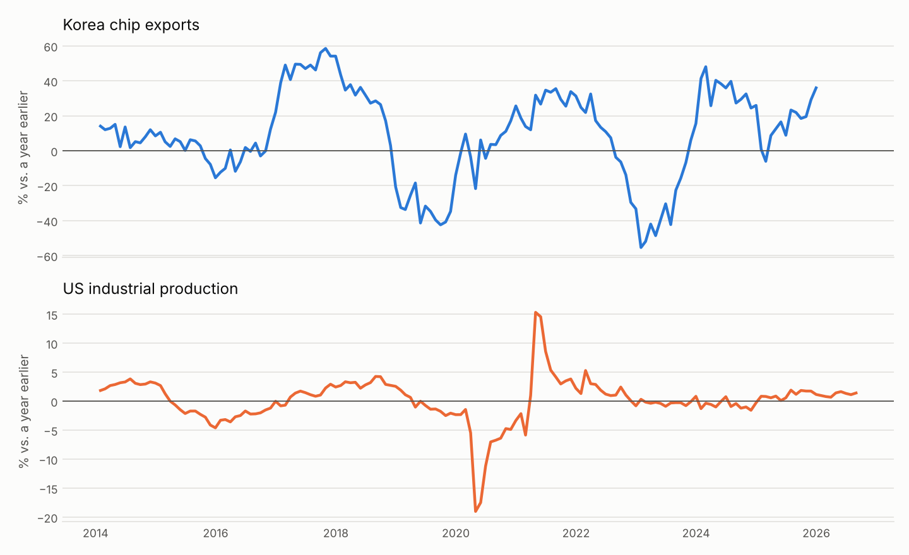
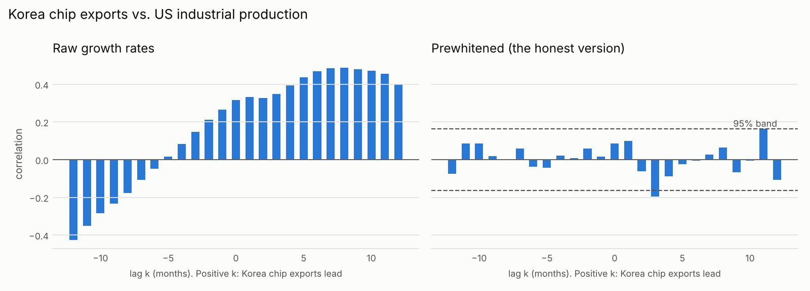
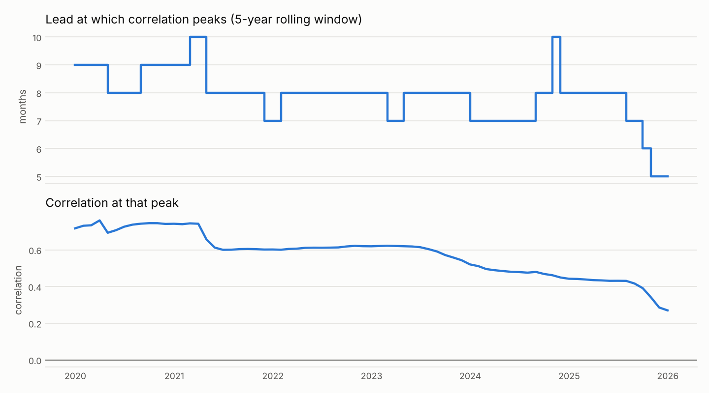
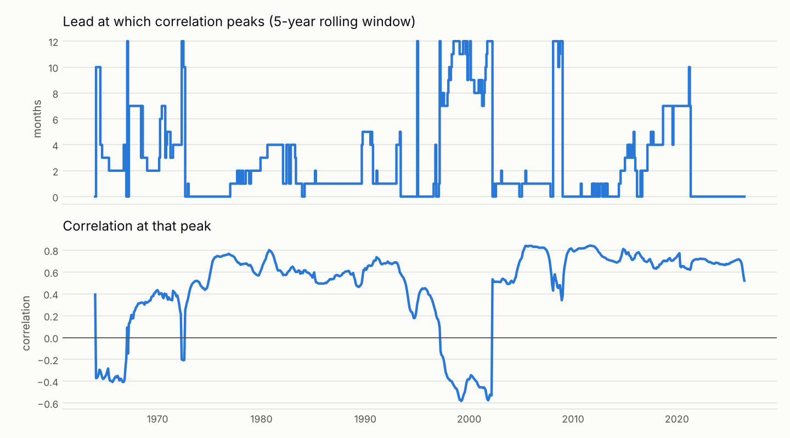
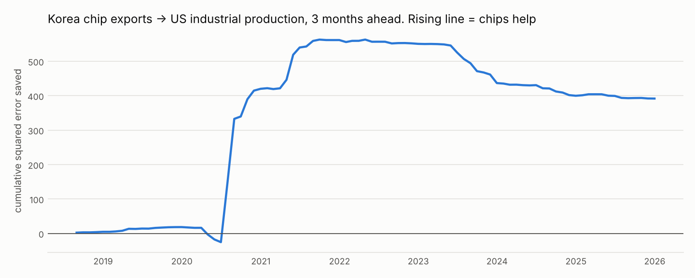

# Results

Generated by `chipcycle analyze`. Every number below comes from that run.

## Stage 2: stationarity of the growth rates

ADF p < 0.05 rejects a unit root; KPSS p > 0.05 fails to reject stationarity. KPSS p-values are capped at 0.01 and 0.10 by its lookup table.

| series | start | end | n | adf_p | kpss_p | stationary |
|---|---|---|---|---|---|---|
| kr_semi_exports | 2014-01 | 2025-12 | 144 | 0.230 | 0.100 | False |
| kr_memory_exports | 2014-01 | 2025-12 | 144 | 0.166 | 0.100 | False |
| kr_exports_total | 1958-01 | 2026-06 | 822 | 0.002 | 0.010 | False |
| us_indpro | 1920-01 | 2026-08 | 1280 | 0.000 | 0.100 | True |
| us_baa_spread | 1987-01 | 2026-10 | 478 | 0.000 | 0.100 | True |
| liquidity | 2003-12 | 2026-10 | 275 | 0.046 | 0.100 | True |
| acwi | 2009-03 | 2026-10 | 212 | 0.000 | 0.100 | True |
| sox | 1996-01 | 2026-10 | 370 | 0.005 | 0.100 | True |
| mu | 1996-01 | 2026-10 | 370 | 0.048 | 0.057 | True |

## Stage 3: lead-lag

`pw_lead_lag`: the lead (0 to 12 months) where the prewhitened cross-correlation is largest. `pw_band`: the 95% significance band; correlations inside it are noise. With 18 pairs tested, about 0.9 would pass at 5% by chance alone.

| signal | target | n | raw_peak_lag | raw_peak_corr | pw_lead_lag | pw_lead_corr | pw_band | granger_p_signal_to_target | granger_p_target_to_signal | var_order |
|---|---|---|---|---|---|---|---|---|---|---|
| kr_semi_exports | us_indpro | 144 | 8 | 0.487 | 3 | -0.195 | 0.163 | 0.156 | 0.714 | 12 |
| kr_semi_exports | us_baa_spread | 144 | -3 | -0.606 | 2 | 0.182 | 0.163 | 0.199 | 0.043 | 12 |
| kr_semi_exports | liquidity | 144 | 12 | -0.508 | 11 | -0.230 | 0.163 | 0.014 | 0.863 | 12 |
| kr_semi_exports | acwi | 144 | -3 | 0.688 | 2 | -0.221 | 0.163 | 0.198 | 0.006 | 12 |
| kr_semi_exports | sox | 144 | -4 | 0.732 | 0 | 0.174 | 0.163 | 0.016 | 0.000 | 2 |
| kr_semi_exports | mu | 144 | -2 | 0.638 | 0 | 0.171 | 0.163 | 0.321 | 0.002 | 12 |
| kr_memory_exports | us_indpro | 144 | 8 | 0.463 | 11 | 0.210 | 0.163 | 0.103 | 0.261 | 12 |
| kr_memory_exports | us_baa_spread | 144 | -3 | -0.587 | 10 | -0.202 | 0.163 | 0.169 | 0.079 | 11 |
| kr_memory_exports | liquidity | 144 | 12 | -0.492 | 11 | -0.230 | 0.163 | 0.072 | 0.072 | 3 |
| kr_memory_exports | acwi | 144 | -2 | 0.680 | 4 | -0.175 | 0.163 | 0.267 | 0.003 | 11 |
| kr_memory_exports | sox | 144 | -3 | 0.695 | 0 | 0.179 | 0.163 | 0.009 | 0.000 | 2 |
| kr_memory_exports | mu | 144 | -1 | 0.641 | 5 | 0.157 | 0.163 | 0.193 | 0.021 | 6 |
| kr_exports_total | us_indpro | 822 | -1 | 0.495 | 0 | 0.232 | 0.068 | 0.001 | 0.000 | 12 |
| kr_exports_total | us_baa_spread | 474 | -2 | -0.487 | 0 | -0.219 | 0.090 | 0.000 | 0.000 | 12 |
| kr_exports_total | liquidity | 271 | -12 | 0.328 | 0 | -0.368 | 0.119 | 0.028 | 0.000 | 12 |
| kr_exports_total | acwi | 208 | -1 | 0.697 | 0 | 0.186 | 0.136 | 0.041 | 0.000 | 12 |
| kr_exports_total | sox | 366 | -1 | 0.479 | 5 | -0.152 | 0.102 | 0.097 | 0.000 | 12 |
| kr_exports_total | mu | 366 | -2 | 0.431 | 8 | -0.181 | 0.102 | 0.001 | 0.000 | 12 |

## Stage 4: stability

**Korea chip exports vs. US industrial production at a 3-month lead, by regime**

| regime | n | corr | ci_low | ci_high |
|---|---|---|---|---|
| 2014-2019 | 72 | 0.65 | 0.49 | 0.77 |
| 2020-2022 | 36 | 0.41 | 0.09 | 0.65 |
| 2023-present (AI cycle) | 36 | 0.16 | -0.18 | 0.46 |

**Korea total exports vs. US industrial production at a 0-month lead, by regime**

| regime | n | corr | ci_low | ci_high |
|---|---|---|---|---|
| 2014-2019 | 72 | 0.59 | 0.41 | 0.72 |
| 2020-2022 | 36 | 0.86 | 0.75 | 0.93 |
| 2023-present (AI cycle) | 42 | 0.37 | 0.08 | 0.61 |

## Stage 5: out-of-sample forecasts

Expanding window, direct forecasts, p = q = 3 lags fixed in advance. `rmse_change_pct` below 0 means chip data reduced forecast error. `dm_p` is the one-sided Diebold-Mariano p-value.

| signal | target | h | n_forecasts | first | rmse_baseline | rmse_with_chips | rmse_change_pct | dm_stat | dm_p |
|---|---|---|---|---|---|---|---|---|---|
| kr_semi_exports | us_indpro | 1 | 93 | 2018-04 | 2.984 | 3.213 | 7.679 | -0.911 | 0.818 |
| kr_semi_exports | us_indpro | 3 | 89 | 2018-08 | 4.877 | 4.403 | -9.724 | 1.052 | 0.148 |
| kr_semi_exports | us_indpro | 6 | 83 | 2019-02 | 6.322 | 5.147 | -18.579 | 1.093 | 0.139 |
| kr_semi_exports | us_baa_spread | 1 | 93 | 2018-04 | 0.249 | 0.261 | 4.603 | -1.702 | 0.954 |
| kr_semi_exports | us_baa_spread | 3 | 89 | 2018-08 | 0.487 | 0.515 | 5.852 | -2.224 | 0.986 |
| kr_semi_exports | us_baa_spread | 6 | 83 | 2019-02 | 0.578 | 0.618 | 7.085 | -1.601 | 0.943 |
| kr_semi_exports | liquidity | 1 | 93 | 2018-04 | 4.957 | 5.053 | 1.944 | -0.568 | 0.714 |
| kr_semi_exports | liquidity | 3 | 89 | 2018-08 | 11.575 | 10.447 | -9.745 | 1.213 | 0.114 |
| kr_semi_exports | liquidity | 6 | 83 | 2019-02 | 15.538 | 14.984 | -3.569 | 0.536 | 0.297 |
| kr_memory_exports | us_indpro | 1 | 93 | 2018-04 | 2.984 | 3.108 | 4.176 | -0.475 | 0.682 |
| kr_memory_exports | us_indpro | 3 | 89 | 2018-08 | 4.877 | 4.346 | -10.903 | 0.992 | 0.162 |
| kr_memory_exports | us_indpro | 6 | 83 | 2019-02 | 6.322 | 5.125 | -18.928 | 0.911 | 0.182 |
| kr_memory_exports | us_baa_spread | 1 | 93 | 2018-04 | 0.249 | 0.259 | 3.810 | -1.483 | 0.929 |
| kr_memory_exports | us_baa_spread | 3 | 89 | 2018-08 | 0.487 | 0.522 | 7.196 | -1.910 | 0.970 |
| kr_memory_exports | us_baa_spread | 6 | 83 | 2019-02 | 0.578 | 0.630 | 9.087 | -1.417 | 0.920 |
| kr_memory_exports | liquidity | 1 | 93 | 2018-04 | 4.957 | 5.024 | 1.347 | -0.436 | 0.668 |
| kr_memory_exports | liquidity | 3 | 89 | 2018-08 | 11.575 | 10.881 | -5.991 | 1.161 | 0.124 |
| kr_memory_exports | liquidity | 6 | 83 | 2019-02 | 15.538 | 15.561 | 0.148 | -0.023 | 0.509 |
| kr_exports_total | us_indpro | 1 | 771 | 1962-04 | 1.306 | 1.313 | 0.537 | -1.333 | 0.908 |
| kr_exports_total | us_indpro | 3 | 767 | 1962-08 | 2.673 | 2.717 | 1.620 | -3.084 | 0.999 |
| kr_exports_total | us_indpro | 6 | 761 | 1963-02 | 3.836 | 3.852 | 0.398 | -0.935 | 0.825 |
| kr_exports_total | us_baa_spread | 1 | 423 | 1991-04 | 0.226 | 0.229 | 1.370 | -1.903 | 0.971 |
| kr_exports_total | us_baa_spread | 3 | 419 | 1991-08 | 0.509 | 0.512 | 0.697 | -0.544 | 0.707 |
| kr_exports_total | us_baa_spread | 6 | 413 | 1992-02 | 0.732 | 0.740 | 1.106 | -0.595 | 0.724 |
| kr_exports_total | liquidity | 1 | 220 | 2008-03 | 18.859 | 19.280 | 2.234 | -1.428 | 0.923 |
| kr_exports_total | liquidity | 3 | 216 | 2008-07 | 33.193 | 32.903 | -0.873 | 0.334 | 0.369 |
| kr_exports_total | liquidity | 6 | 210 | 2009-01 | 90.929 | 92.593 | 1.830 | -1.336 | 0.909 |

### Markets

On the 16th of each month, after Korea's customs release, predict the next 3 months' log return from the latest published chip growth figure. Baseline: the historical average return. `oos_r2_pct` above 0 means beating that baseline out of sample.

| signal | market | h_months | n_forecasts | first | oos_r2_pct | dm_stat | dm_p | hit_rate_pct | avg_fwd_when_long_pct | avg_fwd_when_out_pct | share_long_pct |
|---|---|---|---|---|---|---|---|---|---|---|---|
| kr_semi_exports | acwi | 3 | 111 | 2017-04 | -3.26 | -2.17 | 0.98 | 36.94 | 0.83 | 5.42 | 54.95 |
| kr_semi_exports | sox | 3 | 111 | 2017-04 | -1.74 | -0.65 | 0.74 | 48.65 | 6.04 | 7.17 | 51.35 |
| kr_semi_exports | mu | 3 | 111 | 2017-04 | -2.61 | -0.87 | 0.81 | 42.34 | 5.31 | 13.97 | 52.25 |
| kr_memory_exports | acwi | 3 | 111 | 2017-04 | -4.12 | -2.02 | 0.98 | 31.53 | -0.01 | 5.56 | 47.75 |
| kr_memory_exports | sox | 3 | 111 | 2017-04 | -2.37 | -1.09 | 0.86 | 45.05 | 6.16 | 7.04 | 51.35 |
| kr_memory_exports | mu | 3 | 111 | 2017-04 | -6.19 | -1.27 | 0.90 | 47.75 | 10.62 | 7.85 | 57.66 |

## Stage 6: Micron

Revenue source: SEC EDGAR.

| quarters | first_quarter | corr_same_quarter | corr_korea_leads_1q | beta | nowcast_quarters | rmse_naive_pp | rmse_korea_pp | direction_right_pct | dm_stat | dm_p |
|---|---|---|---|---|---|---|---|---|---|---|
| 47 | 2014-05 | 0.93 | 0.78 | 1.04 | 35 | 21.48 | 15.63 | 91.43 | 1.67 | 0.05 |

